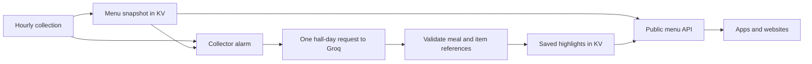

# Groq menu highlights

The API generates highlights centrally with `openai/gpt-oss-120b`, low reasoning effort, and strict JSON output. Apps download saved results. They do not need Groq credentials or their own prompts.

## Data flow



The existing `MenuCollector` owns generation through alarms. No new Cloudflare resource or migration is required. Generation starts after the hourly menu snapshot has been saved, so inference cannot delay publishing menus. Alarms perform one request at a time, with at least 65 seconds between normal attempts. The complete hall-day input retains meal and station groupings. The prompt includes names, descriptions, vegan/vegetarian/plant-based flags, and featured status. Station names appear once per station; nutrition and allergen metadata stay out of the prompt and remain available in the API.

The local version 8 candidate selects up to five distinct offerings per meal, with no minimum. It can group genuine alternatives with a short source-grounded title and explicitly requests their available counterparts. Original item names and metadata remain unchanged. Singleton display titles come from source names; only combined variants use generated wording. Empty services remain empty and menu content is data. The prompt requests mains and named programs, but live tests still found sides, headings and ranking mistakes. This candidate has not been deployed or established better overall food quality. See [the grouping experiment](highlight-grouping.md).

The request schema requires every meal and limits each selection to five items, with zero items for empty services. The server checks that every meal occurs once, every item belongs to its meal, and IDs are neither duplicated nor invented. Inference uses short IDs unique across the hall-day to reduce token usage while detecting cross-meal references. The server resolves them to the original positional IDs and menu objects before storing or serving selections.

## API contract

| Request | Behavior |
| --- | --- |
| `/v1/menus` | All halls, with saved highlights or a status |
| `/v1/menus/collins?highlights=true` | Explicitly include highlights for one hall |
| `/v1/menus?highlights=false` | Omit highlights and skip their KV read |
| `/v1/menus/collins?date=2026-09-29&highlights=false` | Combine date selection and opt-out |

Use a date within the API's supported window. Only the literal values `true` and `false` are accepted, at most once. The default is `true`.

An example `highlights` field on a hall response:

```json
{
  "status": "ready",
  "provider": "groq",
  "model": "openai/gpt-oss-120b",
  "generatedAt": "2026-09-29T14:03:00.000Z",
  "menuVersion": "<content hash>",
  "meals": [
    {
      "mealIndex": 0,
      "name": "Lunch",
      "items": [
        {
          "id": "m0:s0:i0",
          "station": "Main",
          "name": "Vegetable curry",
          "vegan": true
        }
      ],
      "groups": [
        {
          "title": "Vegetable curry",
          "kind": "single",
          "sourceIds": ["m0:s0:i0"],
          "componentIds": [],
          "sourceItems": [{"id": "m0:s0:i0", "station": "Main", "name": "Vegetable curry", "vegan": true}],
          "componentItems": []
        }
      ]
    }
  ]
}
```

`mealIndex` points into the hall's base `meals` array. Item IDs identify positions within this menu version. They are not permanent dish IDs. The selected items carry the same optional descriptions, dietary flags, calories, and allergens as their source items. The API adds no inferred dietary labels. Existing apps can render `items`, one original anchor per offering. New apps render `groups[].title` and use `sourceItems` for the underlying choices and individual metadata. A title such as "Chicken or beef bulgogi" can cover two source items while using one slot. Groups have no aggregate dietary or allergen flags.

`kind: single` means one source row, including a named meal program. New minimal inference does not generate component links; `componentIds` and `componentItems` are empty. Stored detailed program groups remain readable. Full menus still include the original program components. Old saved flat selections for the current menu hash render singleton groups.

| Status | Meaning |
| --- | --- |
| `ready` | Valid selections match this exact menu content |
| `pending` | No matching saved result yet, including after menu changes |
| `unavailable` | Generation failed, input exceeded the size guard, or saved selections failed validation |
| `disabled` | Missing Groq secret or operator kill switch is off |
| `not_applicable` | Closed/unavailable hall or a future date |

Every non-ready result has `meals: []`. Unavailable results can include `reason`: `daily_budget_exhausted`, `attempts_exhausted`, `input_too_large`, or `generation_failed`. A ready result can also have empty item lists for meals without credible mains. Clients should render the full menu when highlights are not ready. `hall.status` still determines menu freshness and availability. A stale menu may have ready highlights matching its saved contents; that does not make the menu freshly verified.

```js
const url = new URL('/v1/menus', apiBase);
url.searchParams.set('highlights', String(settings.showHighlights));
const response = await fetch(url);
const data = await response.json();
if (!Array.isArray(data.halls)) throw new Error(data.error?.message ?? 'Menu request failed');
for (const hall of data.halls) {
  // Keep handling hall.status, including stale and unavailable.
  const featuredMeals = hall.highlights?.status === 'ready'
    ? hall.highlights.meals
    : [];
  renderHall(hall, featuredMeals);
}
```

Opt-out controls the response for that request. It does not stop shared background generation. Operators can stop generation and serving with `HIGHLIGHTS_ENABLED="false"`. Existing edge/browser responses can remain cached for up to 60 seconds, plus KV propagation time for changed records.

## Persistence and retries

The menu snapshot stays at `snapshot:v1`; optional results live at `highlights:v1`. Enabled requests for today make one additional KV read for the entire combined response. Future-date requests skip that read. Opt-out keeps the original single-read path. A highlights storage failure does not cause a menu error.

A SHA-256 digest covers hall, date, ordered meal/item content, model, prompt version, and the actual hall-specific system prompt. Last-checked timestamps and meal hours do not affect selection. Changed food, labels, or ordering invalidate old selections immediately when that menu snapshot is served. The API never combines a new menu with old selections. This also handles KV keys arriving at different times.

The collector stores attempts and results durably before publishing to KV. A failed publish can retry without repeating inference. A crash after Groq accepts a request but before the result is saved can cause a repeat call. Exactly-once inference is not guaranteed.

Each distinct hall-day version gets up to three reserved outbound attempts. Completed and failed versions are retained for that day, so a source changing A to B and back to A reuses A instead of resetting its attempts. Fresh halls get a first attempt before retries. HTTP 429 and 5xx are retryable; other Groq HTTP errors stop that version. Retry-After starts when the error arrives and pauses all halls, because provider quotas are shared. That cooldown survives California midnight. The collector caps reserved outbound attempts at 21 across all halls per California service day, including menu revisions and retries. Local oversized-input rejection consumes no request allowance. Reservations happen before network I/O, so a crash can consume allowance without sending a request. Exhausted versions receive an unavailable status instead of remaining pending. This limits calls, not tokens or spending. Configure provider account limits separately and inspect token usage logs.

## Setup

Store `GROQ_API_KEY` as a Worker secret through Wrangler or the Cloudflare dashboard. Do not put it in an app or committed configuration. For local development, use an ignored `.dev.vars` file. The secret's presence enables generation unless `HIGHLIGHTS_ENABLED` is `false`.

Deploy the code after setting up the secret. The next hourly collection schedules generation. Until results arrive, apps see `pending`. Without a secret, they see `disabled`. No public request starts generation or permits a caller to force regeneration.

## Initial limits and evaluation

See [the refinement report](highlight-refinement.md) and [actual tested picks](highlight-selections.md) for the October 3 prompt-version-5 loop. Known non-main errors improved, while some ranking preferences and occasional invalid references still require evaluation and bounded retries.

This version generates only today's menus in California time. Future dates remain fully available as menus with `not_applicable` highlights. Seven requests is a baseline for seven available, unchanged hall-days, not a promise when menus change or retries occur.

Requests have a 45-second timeout, a 24,000-byte menu input guard, and a 2,000-token completion allowance including reasoning. The byte guard is not a tokenizer and does not guarantee fitting an account's tokens-per-minute limit. Oversized hall-days currently report unavailable highlights; automatic splitting by meal is a follow-up. Test actual menus before choosing that threshold or increasing completion limits. Groq can also reject smaller inputs based on current quota usage.

Log events report hall/date, attempt failures, and successful prompt/completion/total token usage. They exclude credentials, raw provider error bodies, and reasoning text.

Before enabling for users, evaluate 30-50 real hall-day menus for mains versus sides, variety, plant-based coverage, repeats, and incomplete services. Compare combined prompts with per-meal prompts on the same menus if quality is inconsistent. Deterministic mocked tests verify the integration; they do not establish selection quality or real token consumption.

References checked September 29, 2026: [GPT-OSS 120B](https://console.groq.com/docs/model/openai/gpt-oss-120b), [strict structured outputs](https://console.groq.com/docs/structured-outputs), [Groq rate limits](https://console.groq.com/docs/rate-limits), [Durable Object alarms](https://developers.cloudflare.com/durable-objects/api/alarms/).


## Audited call counts

| Situation | Additional Groq calls |
| --- | --- |
| Seven available halls, first generation today | Seven, one complete hall-day per request |
| Repeated hourly checks with unchanged food | Zero |
| Any number of app/API requests | Zero |
| One hall's food changes to a new version | Normally one |
| Source reverts to an already completed version today | Zero |
| Tomorrow through six days ahead | Zero in this implementation |
| Retryable error or incomplete/invalid response | Up to three total reserved attempts for that version |
| Closed, unavailable, or stale menu awaiting verification | Zero new generation calls |
| Missing secret or operator kill switch | Zero |

The global ceiling is 21 reserved attempts per California day, not 21 per hall. An individual hall can exceed one call if its menu changes repeatedly. A literal one-call-per-day policy would prevent corrections after food changes; this implementation deliberately reuses results by menu content instead.

If highlights later cover the full seven-day window, initial generation could require up to 49 hall-day requests. With caching, subsequent work would cover new dates and changed menus, rather than repeating all 49 requests every day. That expansion would require revisiting the current 21-attempt budget and today-only storage policy.

See [the audit report](menu-highlights-audit.md) for findings, fixes, live payload measurements, and verification limits.


## Live validation

The October 2 live run completed all six available halls in six Groq calls, totaling 25,195 tokens. It exposed and fixed omission of empty services by requiring every meal ID as a key in the strict output schema. The public response shape is unchanged. See [live test results](menu-highlights-live-test.md) for usage, API checks, and selection-quality caveats.
